# Play and Tactic FSM Diagrams

## [PlaySelectionFSM](/src/software/ai/play_selection_fsm.h)

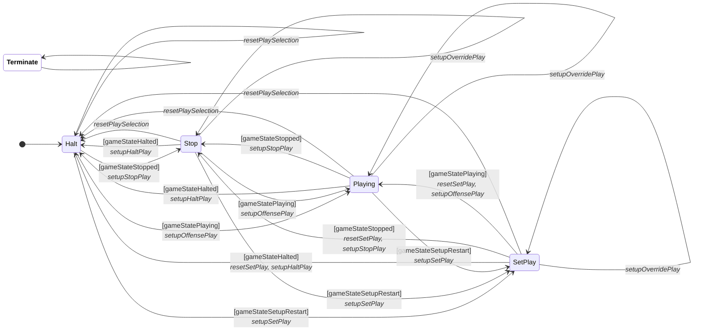

## [StopPlayFSM](/src/software/ai/stp/play/stop_play_fsm.h)

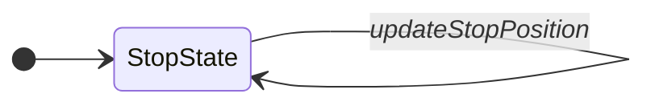

## [BallPlacementPlayFSM](/src/software/ai/stp/play/ball_placement/ball_placement_play_fsm.h)

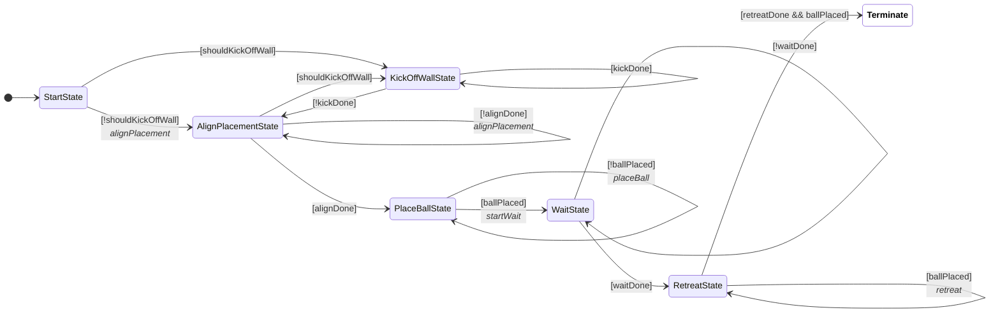

## [CreaseDefensePlayFSM](/src/software/ai/stp/play/crease_defense/crease_defense_play_fsm.h)

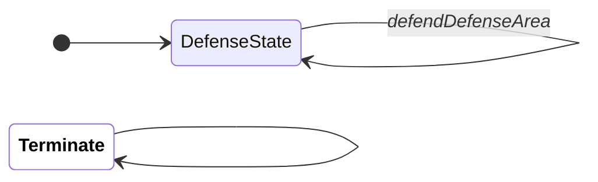

## [DefensePlayFSM](/src/software/ai/stp/play/defense/defense_play_fsm.h)

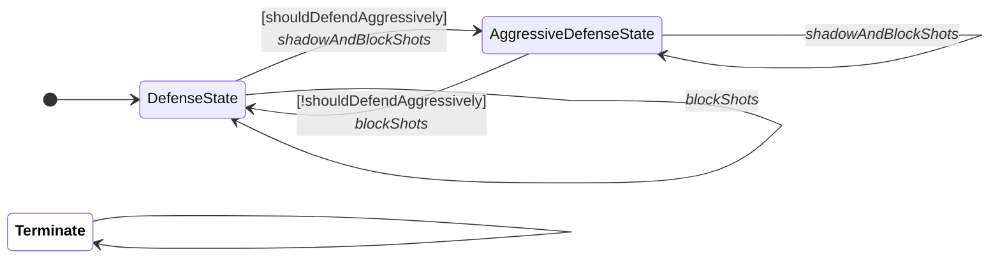

## [EnemyBallPlacementPlayFSM](/src/software/ai/stp/play/enemy_ball_placement/enemy_ball_placement_play_fsm.h)

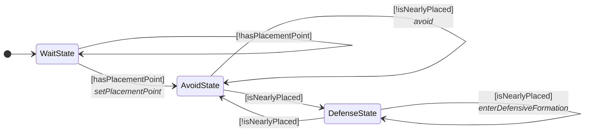

## [EnemyFreeKickPlayFSM](/src/software/ai/stp/play/enemy_free_kick/enemy_free_kick_play_fsm.h)

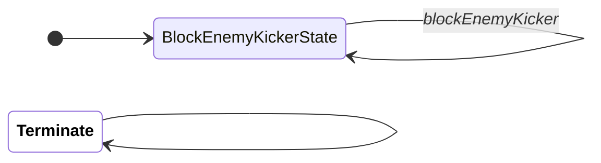

## [ExamplePlayFSM](/src/software/ai/stp/play/example/example_play_fsm.h)

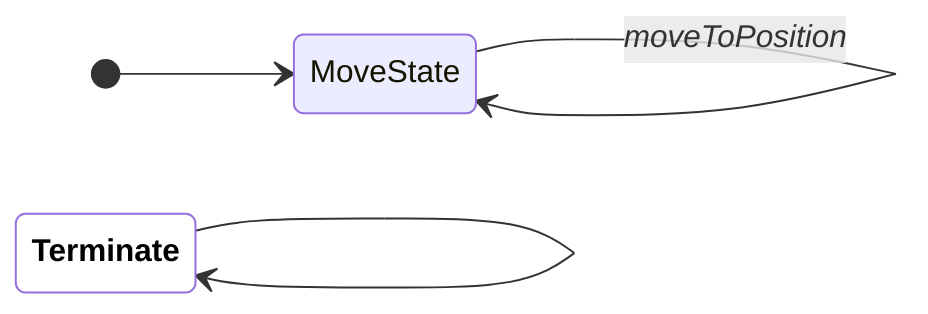

## [FreeKickPlayFSM](/src/software/ai/stp/play/free_kick/free_kick_play_fsm.h)

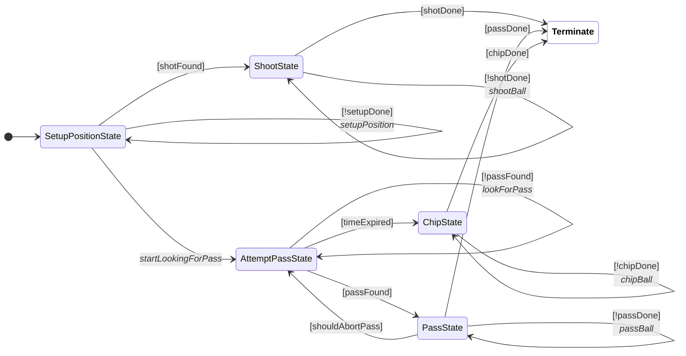

## [HaltPlayFSM](/src/software/ai/stp/play/halt_play/halt_play_fsm.h)

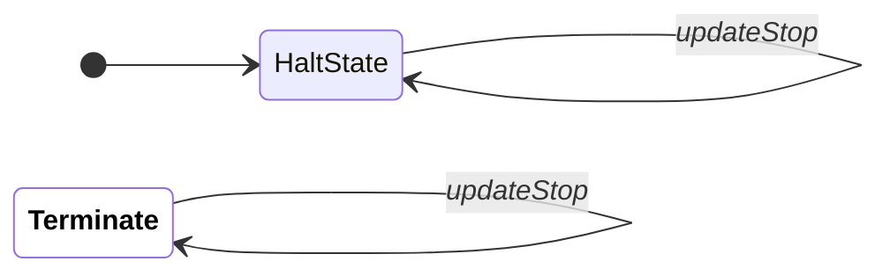

## [KickoffEnemyPlayFSM](/src/software/ai/stp/play/kickoff_enemy/kickoff_enemy_play_fsm.h)

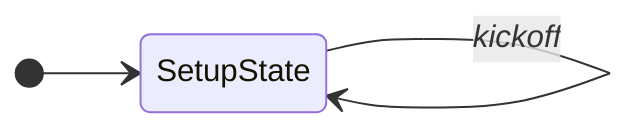

## [KickoffFriendlyPlayFSM](/src/software/ai/stp/play/kickoff_friendly/kickoff_friendly_play_fsm.h)

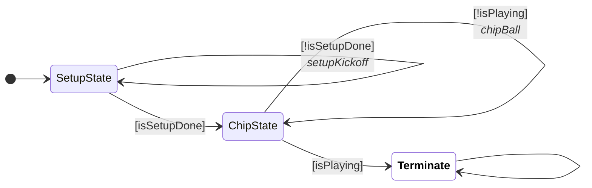

## [OffensePlayFSM](/src/software/ai/stp/play/offense/offense_play_fsm.h)

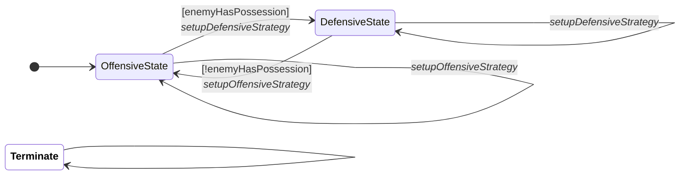

## [PenaltyKickPlayFSM](/src/software/ai/stp/play/penalty_kick/penalty_kick_play_fsm.h)

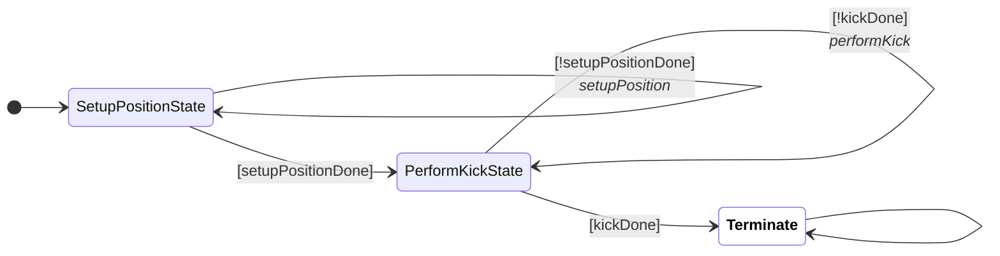

## [PenaltyKickEnemyPlayFSM](/src/software/ai/stp/play/penalty_kick_enemy/penalty_kick_enemy_play_fsm.h)

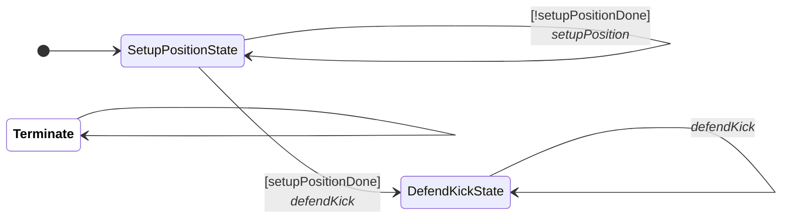

## [ShootOrChipPlayFSM](/src/software/ai/stp/play/shoot_or_chip/shoot_or_chip_play_fsm.h)

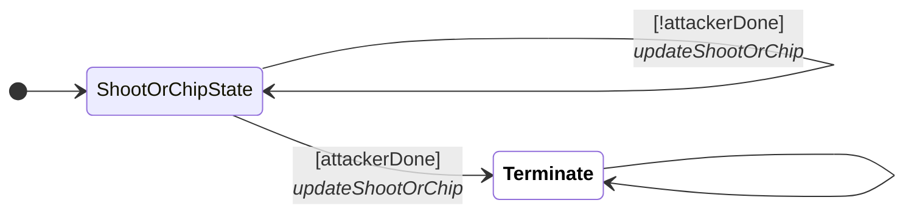

## [ShootOrPassPlayFSM](/src/software/ai/stp/play/shoot_or_pass/shoot_or_pass_play_fsm.h)

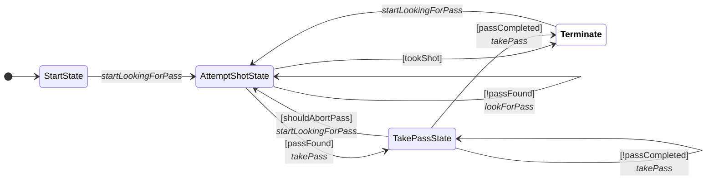

## [AttackerFSM](/src/software/ai/stp/tactic/attacker/attacker_fsm.h)

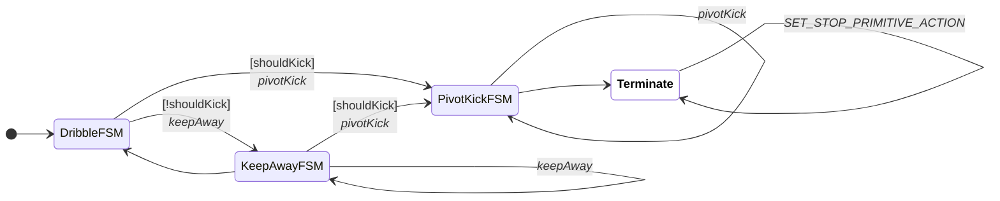

## [CreaseDefenderFSM](/src/software/ai/stp/tactic/crease_defender/crease_defender_fsm.h)

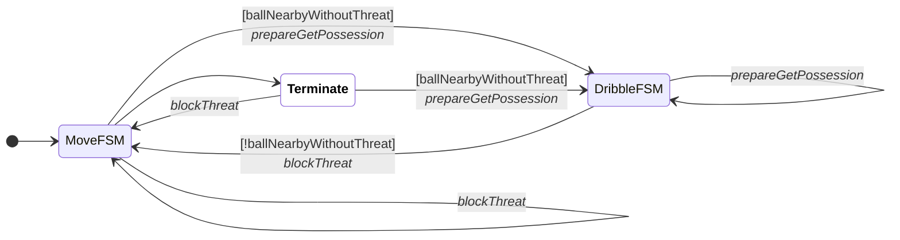

## [DribbleFSM](/src/software/ai/stp/tactic/dribble/dribble_fsm.h)

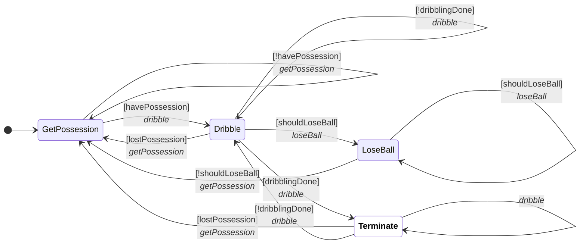

## [GetBehindBallFSM](/src/software/ai/stp/tactic/get_behind_ball/get_behind_ball_fsm.h)

```mermaid

stateDiagram-v2
classDef terminate fill:white,color:black,font-weight:bold
direction LR
[*] --> GetBehindBallState
GetBehindBallState --> GetBehindBallState : [!behindBall]<br><i>updateMove</i>
GetBehindBallState --> Terminate:::terminate : [behindBall]<br><i>updateMove</i>
Terminate:::terminate --> GetBehindBallState : [!behindBall]<br><i>updateMove</i>
Terminate:::terminate --> Terminate:::terminate : <i>SET_STOP_PRIMITIVE_ACTION</i>

```

## [GoalieFSM](/src/software/ai/stp/tactic/goalie/goalie_fsm.h)

```mermaid

stateDiagram-v2
classDef terminate fill:white,color:black,font-weight:bold
direction LR
[*] --> PositionToBlock
PositionToBlock --> MoveToGoalLine : [shouldMoveToGoalLine]<br><i>moveToGoalLine</i>
PositionToBlock --> DribbleFSM : [shouldEvacuateCrease]<br><i>retrieveFromDeadZone</i>
PositionToBlock --> Panic : [shouldPanic]<br><i>panic</i>
PositionToBlock --> PivotKickFSM : [shouldPivotChip]<br><i>updatePivotKick</i>
PositionToBlock --> PositionToBlock : <i>positionToBlock</i>
DribbleFSM --> PivotKickFSM : [retrieveDone]<br><i>updatePivotKick</i>
DribbleFSM --> MoveToGoalLine : [shouldMoveToGoalLine]<br><i>moveToGoalLine</i>
DribbleFSM --> DribbleFSM : [ballInInflatedDefenseArea]<br><i>retrieveFromDeadZone</i>
DribbleFSM --> PositionToBlock : [!ballInInflatedDefenseArea]<br><i>positionToBlock</i>
Panic --> MoveToGoalLine : [shouldMoveToGoalLine]<br><i>moveToGoalLine</i>
Panic --> PivotKickFSM : [shouldPivotChip]<br><i>updatePivotKick</i>
Panic --> PositionToBlock : [panicDone]<br><i>positionToBlock</i>
Panic --> Panic : <i>panic</i>
PivotKickFSM --> MoveToGoalLine : [shouldMoveToGoalLine]<br><i>moveToGoalLine</i>
PivotKickFSM --> PivotKickFSM : [ballInInflatedDefenseArea]<br><i>updatePivotKick</i>
PivotKickFSM --> PositionToBlock : [!ballInInflatedDefenseArea]<br><i>positionToBlock</i>
MoveToGoalLine --> MoveToGoalLine : [shouldMoveToGoalLine]<br><i>moveToGoalLine</i>
MoveToGoalLine --> PositionToBlock : [!shouldMoveToGoalLine]<br><i>positionToBlock</i>
Terminate:::terminate --> Terminate:::terminate

```

## [HaltFSM](/src/software/ai/stp/tactic/halt/halt_fsm.h)

```mermaid

stateDiagram-v2
classDef terminate fill:white,color:black,font-weight:bold
direction LR
[*] --> StopState
StopState --> StopState : [!stopDone]<br><i>updateStop</i>
StopState --> Terminate:::terminate : [stopDone]<br><i>updateStop</i>
Terminate:::terminate --> StopState : [!stopDone]<br><i>updateStop</i>
Terminate:::terminate --> Terminate:::terminate : [stopDone]<br><i>updateStop</i>

```

## [KeepAwayFSM](/src/software/ai/stp/tactic/keep_away/keep_away_fsm.h)

```mermaid

stateDiagram-v2
classDef terminate fill:white,color:black,font-weight:bold
direction LR
[*] --> DribbleFSM
DribbleFSM --> DribbleFSM : <i>keepAway</i>
DribbleFSM --> Terminate:::terminate
Terminate:::terminate --> Terminate:::terminate : <i>SET_STOP_PRIMITIVE_ACTION</i>

```

## [KickOrChipFSM](/src/software/ai/stp/tactic/kick_or_chip/kick_or_chip_fsm.h)

```mermaid

stateDiagram-v2
classDef terminate fill:white,color:black,font-weight:bold
direction LR
[*] --> GetBehindBallFSM
GetBehindBallFSM --> GetBehindBallFSM : <i>updateGetBehindBall</i>
GetBehindBallFSM --> KickOrChipState
KickOrChipState --> GetBehindBallFSM : [shouldRealignWithBall]<br><i>updateGetBehindBall</i>
KickOrChipState --> KickOrChipState : [!ballChicked]<br><i>kickOrChipBall</i>
KickOrChipState --> Terminate:::terminate : [ballChicked]<br><i>SET_STOP_PRIMITIVE_ACTION</i>
Terminate:::terminate --> Terminate:::terminate : <i>SET_STOP_PRIMITIVE_ACTION</i>

```

## [MoveFSM](/src/software/ai/stp/tactic/move/move_fsm.h)

```mermaid

stateDiagram-v2
classDef terminate fill:white,color:black,font-weight:bold
direction LR
[*] --> MoveState
MoveState --> MoveState : [!moveDone]<br><i>updateMove</i>
MoveState --> Terminate:::terminate : [moveDone]<br><i>updateMove</i>
Terminate:::terminate --> MoveState : [!moveDone]<br><i>updateMove</i>
Terminate:::terminate --> Terminate:::terminate : <i>updateMove</i>

```

## [PassDefenderFSM](/src/software/ai/stp/tactic/pass_defender/pass_defender_fsm.h)

```mermaid

stateDiagram-v2
classDef terminate fill:white,color:black,font-weight:bold
direction LR
[*] --> BlockPassState
BlockPassState --> InterceptBallState : [passStarted]<br><i>interceptBall</i>
BlockPassState --> BlockPassState : <i>blockPass</i>
InterceptBallState --> BlockPassState : [ballDeflected]<br><i>blockPass</i>
InterceptBallState --> DribbleFSM : [ballNearbyWithoutThreat]<br><i>prepareGetPossession</i>
DribbleFSM --> BlockPassState : [!ballNearbyWithoutThreat]<br><i>blockPass</i>
DribbleFSM --> DribbleFSM : <i>prepareGetPossession</i>
InterceptBallState --> InterceptBallState : <i>interceptBall</i>
Terminate:::terminate --> Terminate:::terminate : <i>SET_STOP_PRIMITIVE_ACTION</i>

```

## [PenaltyKickFSM](/src/software/ai/stp/tactic/penalty_kick/penalty_kick_fsm.h)

```mermaid

stateDiagram-v2
classDef terminate fill:white,color:black,font-weight:bold
direction LR
[*] --> DribbleFSM
DribbleFSM --> DribbleFSM : [!takePenaltyShot]<br><i>updateApproachKeeper</i>
DribbleFSM --> KickOrChipFSM : [timeOutApproach]<br><i>shoot</i>
DribbleFSM --> DribbleFSM : <i>adjustOrientationForShot</i>
DribbleFSM --> KickOrChipFSM
KickOrChipFSM --> KickOrChipFSM : <i>shoot</i>
KickOrChipFSM --> Terminate:::terminate
Terminate:::terminate --> Terminate:::terminate : <i>SET_STOP_PRIMITIVE_ACTION</i>

```

## [PivotKickFSM](/src/software/ai/stp/tactic/pivot_kick/pivot_kick_fsm.h)

```mermaid

stateDiagram-v2
classDef terminate fill:white,color:black,font-weight:bold
direction LR
[*] --> StartState
StartState --> DribbleFSM : <i>getPossessionAndPivot</i>
DribbleFSM --> DribbleFSM : <i>getPossessionAndPivot</i>
DribbleFSM --> KickState
KickState --> KickState : [!ballKicked]<br><i>kickBall</i>
KickState --> Terminate:::terminate : [ballKicked]<br><i>SET_STOP_PRIMITIVE_ACTION</i>
Terminate:::terminate --> Terminate:::terminate : <i>SET_STOP_PRIMITIVE_ACTION</i>

```

## [ReceiverFSM](/src/software/ai/stp/tactic/receiver/receiver_fsm.h)

```mermaid

stateDiagram-v2
classDef terminate fill:white,color:black,font-weight:bold
direction LR
[*] --> WaitingForPassState
WaitingForPassState --> WaitingForPassState : [!passStarted]<br><i>updateReceive</i>
WaitingForPassState --> OneTouchShotState : [passStarted && onetouchPossible]<br><i>updateOnetouch</i>
WaitingForPassState --> ReceiveAndDribbleState : [passStarted && !onetouchPossible]<br><i>updateReceive</i>
ReceiveAndDribbleState --> ReceiveAndDribbleState : [!passFinished]<br><i>adjustReceive</i>
OneTouchShotState --> OneTouchShotState : [!passFinished && !strayPass]<br><i>updateOnetouch</i>
OneTouchShotState --> ReceiveAndDribbleState : [!passFinished && strayPass]<br><i>adjustReceive</i>
ReceiveAndDribbleState --> Terminate:::terminate : [passFinished]<br><i>adjustReceive</i>
OneTouchShotState --> Terminate:::terminate : [passFinished]<br><i>updateOnetouch</i>
Terminate:::terminate --> Terminate:::terminate : <i>SET_STOP_PRIMITIVE_ACTION</i>

```

## [ShadowEnemyFSM](/src/software/ai/stp/tactic/shadow_enemy/shadow_enemy_fsm.h)

```mermaid

stateDiagram-v2
classDef terminate fill:white,color:black,font-weight:bold
direction LR
[*] --> MoveFSM
MoveFSM --> BlockPassState : [!enemyThreatHasBall]<br><i>blockPass</i>
MoveFSM --> GoAndStealState : [blockedShot]<br><i>goAndSteal</i>
MoveFSM --> MoveFSM : <i>blockShot</i>
MoveFSM --> GoAndStealState
BlockPassState --> BlockPassState : [!enemyThreatHasBall]<br><i>blockPass</i>
BlockPassState --> MoveFSM : [enemyThreatHasBall]<br><i>blockShot</i>
GoAndStealState --> GoAndStealState : [enemyThreatHasBall && !contestedBall]<br><i>goAndSteal</i>
GoAndStealState --> StealAndPullState : [enemyThreatHasBall && contestedBall]<br><i>goAndSteal</i>
GoAndStealState --> Terminate:::terminate : [!enemyThreatHasBall]<br><i>blockPass</i>
StealAndPullState --> StealAndPullState : [enemyThreatHasBall]<br><i>stealAndPull</i>
StealAndPullState --> Terminate:::terminate : [!enemyThreatHasBall]<br><i>blockPass</i>
Terminate:::terminate --> BlockPassState : [!enemyThreatHasBall]<br><i>blockPass</i>
Terminate:::terminate --> MoveFSM : [enemyThreatHasBall]<br><i>blockShot</i>
Terminate:::terminate --> Terminate:::terminate : <i>SET_STOP_PRIMITIVE_ACTION</i>

```

